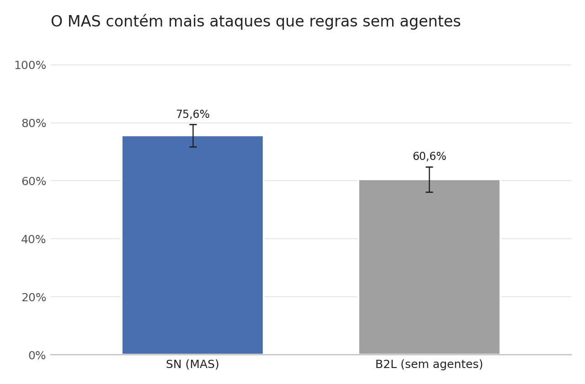
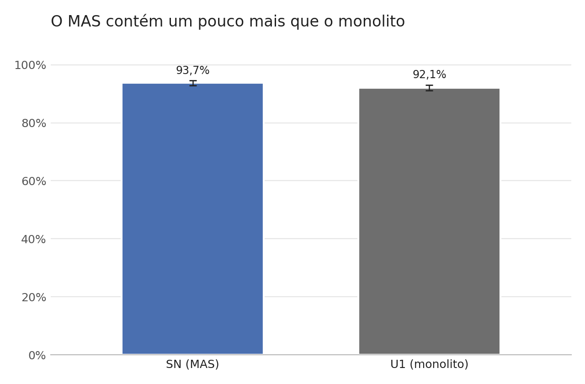
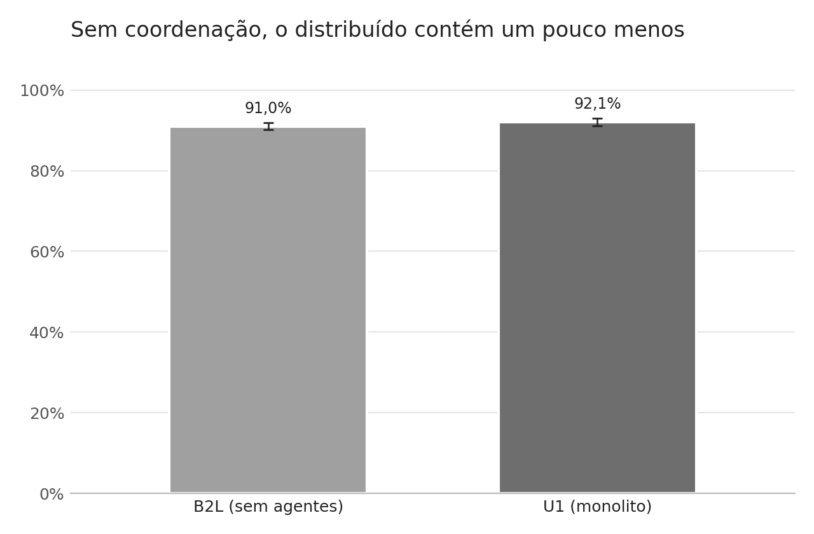
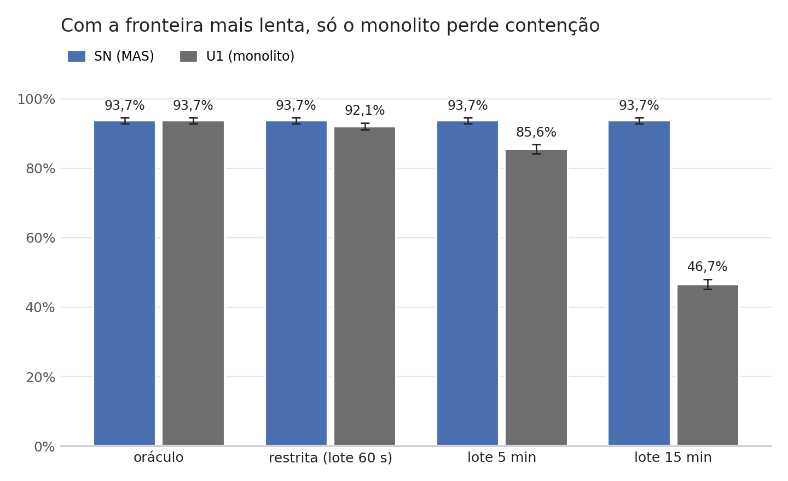
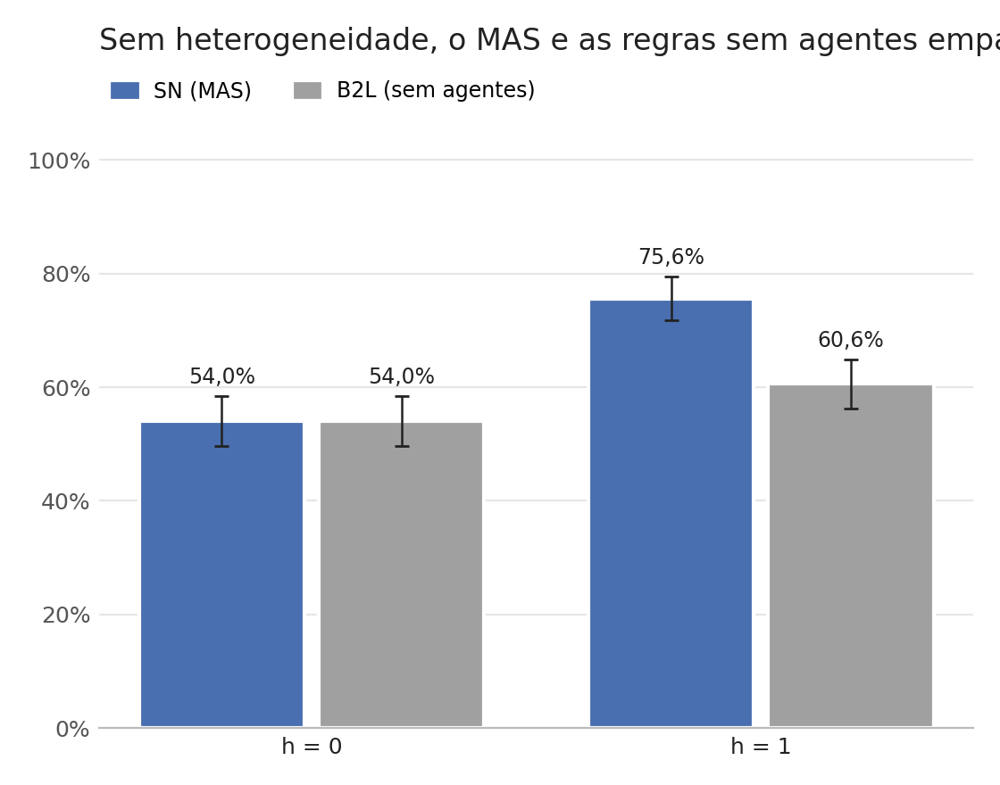
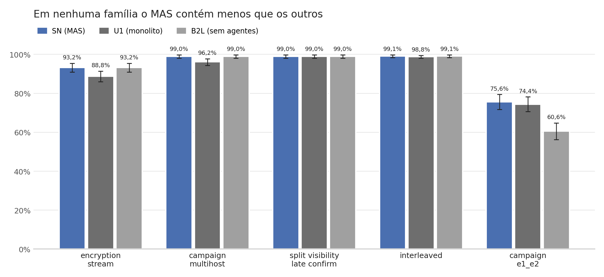
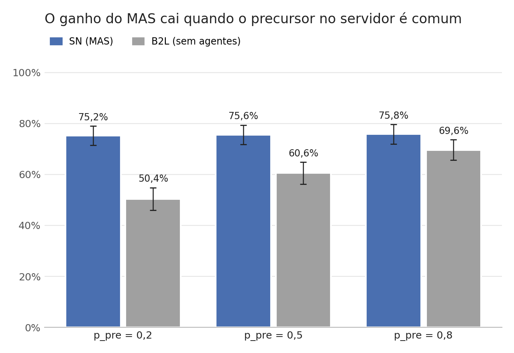
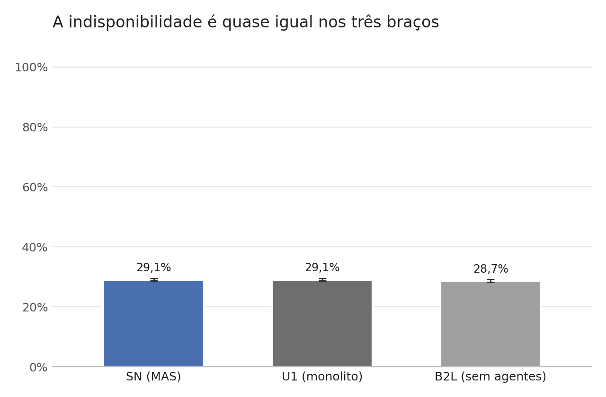

# Fase 1 — 09. Relatório da execução OFICIAL (confirmatória)

> **CONFIRMATÓRIO.** Pré-registro congelado: `docs/fase1/08_preregistro_oficial.md`
> (`08_preregistro_oficial.freeze.json`: **2026-11-03T12:53:52Z**, commit `d7e27df`). As hipóteses
> vieram do piloto EXPLORATORY da Fase 1b (`results/fase1b_pilot/`). Seeds novas: 5000–5499.

**Afirmação testada:** o MAS (SN) une a coordenação do monolito à localidade do distribuído.

- **Dados:** `results/fase1_oficial/raw/` (39 blocos) e `manifest.json` (sha256, commit, Python
  3.9.6 e comando de cada bloco).
- **Análise:** `results/fase1_oficial/summary.json`.
- **Figuras:** `results/fase1_oficial/figs/`.
- **Comandos:** `python3 simulation/fase1_oficial_experiments.py {run --block …, check-pre, analyze}`
  e `python3 analysis/fase1_oficial_figs.py`. O pacote `replication/` reproduz tudo com um comando.
- **Braços:** SN = MAS proposto; U1 = MAPE-K monolítico; B2L = distribuído sem agentes. A
  configuração é a mesma da Fase 1b.

## Pré-condições

| Teste | Resultado | Veredito |
|---|---|---|
| **R:** regressão da Fase 8 (34 unidades), da Fase 1 (16 unidades) e da Fase 1b (20 unidades do piloto, rodadas pelo driver oficial) | 87 de 87 testes passam, linhas idênticas byte a byte (`R_pytest.txt`) | **passa** |
| **H0:** oráculo, SN × U1, 5 famílias, h = 0 | Δ = 0,0 pp, IC95 % [0,0; 0,0], n = 2 760 | **passa** |
| **H0:** oráculo, SN × U1, 5 famílias, h = 1 | Δ = 0,0 pp, IC95 % [0,0; 0,0], n = 2 760 | **passa** |
| **C0:** h = 0, `campaign_e1_e2`, restrita, SN × B2L | Δ = 0,0 pp, IC95 % [0,0; 0,0], n = 500, nenhum par discordante | **passa** |

## Tabela-resumo (família confirmatória, Holm, α = 0,05, unilateral)

| Hipótese | Recorte | p(SN) | p(comparador) | Δ | IC95 % | p bruto | p ajustado (Holm) | Δ indisponibilidade | Veredito |
|---|---|---|---|---|---|---|---|---|---|
| **H1:** SN > B2L | `campaign_e1_e2`, h = 1, restrita | 75,6 % | 60,6 % | **+15,0 pp** | [+12,0; +18,2] | 2,6 × 10⁻²³ | 7,9 × 10⁻²³ | +0,7 pp | **confirmada** |
| **H2:** SN − U1 > −5 pp | 5 famílias, h = 1, restrita | 93,7 % | 92,1 % | **+1,6 pp** | [+1,2; +2,1] | 1,0 × 10⁻⁴ ¹ | 1,0 × 10⁻⁴ | +0,02 pp | **confirmada** |
| **H3:** SN > U1 | mesmo de H2 | 93,7 % | 92,1 % | **+1,6 pp** | [+1,2; +2,1] | 5,7 × 10⁻¹⁴ | 1,1 × 10⁻¹³ | +0,02 pp | **confirmada** |
| **H4:** Δ(SN − U1) cresce com F2 | 5 famílias, h = 1, 4 níveis | — | — | **β₃ = +1,13** (logit) ² | [+1,06; +1,20] | < 10⁻²⁰⁰ ³ | < 10⁻²⁰⁰ | ≤ +0,16 pp em cada nível | **confirmada** |

1. O p de H2 é o menor valor possível com 10 000 reamostragens, 1/10 001: nenhuma reamostragem
   chegou a −5 pp. O limite inferior unilateral de 95 % é +1,2 pp.
2. Em pontos percentuais, Δ por nível: oráculo 0,0 [0,0; 0,0]; restrita +1,6 [+1,2; +2,1];
   lote 5 min +8,2 [+7,1; +9,2]; lote 15 min +47,1 [+45,7; +48,4].
3. O valor calculado é 8,5 × 10⁻²²⁷ pela aproximação normal. Um número tão pequeno não tem
   significado próprio; quer dizer apenas que o efeito está muito longe de zero.

**Pares discordantes (McNemar):** em H1, o SN contém e o B2L não em 75 campanhas, e o inverso nunca
ocorre. Em H3 são 44 e 0. Em nenhuma comparação o SN perde uma campanha que o comparador contém.

## Gráficos

### 1. Agêntico × sem agentes

Na família em que o ataque passa de uma estação para um servidor de outro segmento, o MAS contém
75,6 % das campanhas, e as regras sem agentes contêm 60,6 %. A diferença vem do aviso que o
especialista da estação manda, pelo coordenador, ao segmento do servidor. O B2L não tem como mandar
esse aviso.

### 2. Distribuído × monolito

Somando as cinco famílias, o MAS contém 93,7 % e o monolito 92,1 %. Distribuir a decisão não custou
contenção, e o MAS ainda ganhou 1,6 ponto. O ganho é pequeno, como o pré-registro previa.

### 3. Distribuído sem coordenação × monolito

Sem agentes nem coordenação, o distribuído contém 91,0 %, 1,1 ponto abaixo do monolito
(IC95 % de −1,9 a −0,4). Os dois braços têm limitações opostas: o B2L decide perto do host, mas não
avisa os outros segmentos, e o monolito avisa, mas decide depois da fronteira. O MAS (gráfico 2)
tem as duas vantagens.

### 4. Custo de fronteira

Quando a telemetria leva mais tempo para chegar ao centro, o monolito contém cada vez menos: 93,7 %,
92,1 %, 85,6 % e 46,7 %. O MAS fica em 93,7 % nos quatro níveis, porque a decisão de conter é
tomada dentro do segmento. Só o aviso entre segmentos cruza a fronteira.

### 5. Heterogeneidade

Com hosts iguais (h = 0), o MAS e as regras sem agentes contêm o mesmo (54,0 %), porque o sinal que
gera o aviso não existe nesse caso. Com hosts heterogêneos (h = 1), o MAS sobe para 75,6 % e o B2L
para 60,6 %. A vantagem do MAS sobre o B2L depende de o sensor da estação ver a conexão para o
servidor.

### 6. Família de ataque

Em nenhuma das cinco famílias o MAS contém menos que os outros dois braços. Contra o monolito, a
vantagem aparece em `encryption_stream` (+4,4 pp), `campaign_multihost` (+2,8 pp) e
`campaign_e1_e2` (+1,2 pp). Contra o B2L, a diferença existe só em `campaign_e1_e2`; nas outras
quatro famílias os dois braços empatam exatamente.

### 7. p_pre

p_pre é a chance de o servidor já ter um sinal próprio antes do ataque. Quanto maior p_pre, mais o
B2L protege o servidor sozinho, e menor fica a vantagem do MAS: +24,8 pp, +15,0 pp e +6,2 pp. O MAS
fica em ≈ 75 % nos três níveis.

### 8. Custo: indisponibilidade

A fração de tempo em que os hosts ficam indisponíveis é quase igual nos três braços: 29,1 %, 29,1 %
e 28,7 %. A vantagem do MAS não foi comprada com mais bloqueios. A diferença máxima em qualquer
recorte é de 0,9 ponto, abaixo do limite de 5.

## Secundárias (descritivas)

| h = 1 | SN | U1 | B2L |
|---|---|---|---|
| Perda por host, restrita (arquivos) | 3 179 | 3 709 | 3 990 |
| Perda por host, lote 15 min | 3 180 | 10 709 | 3 990 |
| Latência média do aviso: restrita / 5 min / 15 min (s) | 51 / 171 / 416 | 51 / 172 / 416 | — |
| Avisos por run / avisos falsos por run | 0,49 / 0,29 | 0,49 / 0,29 | 0 / 0 |
| Avisos que chegaram depois do impacto no host avisado, dos 500 com impacto (restrita / 5 min / 15 min) | 0 / 0 / 25 | 0 / 0 / 25 | — |

- **O risco declarado em H4 ocorreu, mas não mudou a métrica primária.** Com lote de 15 min, 25 dos
  500 avisos cujo host avisado sofreu impacto chegaram depois dele, no SN e no U1. Mesmo assim, nenhuma
  campanha mudou de "contida" para "não contida" no SN, nem em relação ao oráculo. Só a perda mudou,
  em 3 unidades.
- **Varredura de p_pre, nível 0,5:** as linhas repetem exatamente a célula principal, como exige o
  §4 do pré-registro (verificação de determinismo).
- **Avisos falsos:** 59 % dos avisos são falsos (servidor benigno isolado depois de uma conexão
  administrativa). O custo deles já está na indisponibilidade acima.

## O que está provado e o que não está

1. Neste simulador, a coordenação do MAS contém mais ataques que regras locais isoladas, na família
   construída para isso: 75,6 % × 60,6 %, +15,0 pp (IC95 % +12,0 a +18,2), com 75 pares a favor do
   MAS e 0 contra.
2. O MAS não perde para o monolito e ganha um pouco dele: 93,7 % × 92,1 %, +1,6 pp (IC95 % +1,2 a
   +2,1). O ganho é pequeno.
3. A vantagem sobre o monolito cresce com o custo da fronteira (0; 1,6; 8,2; 47,1 pp; β₃ = +1,13),
   porque o MAS fica em 93,7 % em todos os níveis e o monolito cai até 46,7 %.
4. Nada disso custou disponibilidade: a diferença ficou em no máximo 0,9 ponto em todos os
   recortes, para um limite de 5.
5. Não está provado que o efeito vale fora deste modelo, nem que o sistema é adaptativo (limiares
   fixos, regras determinísticas). A coordenação só faz diferença em `campaign_e1_e2`: Δ(SN − B2L)
   = 0 nas outras quatro famílias.

## Desvios (declarados, com data)

1. **2026-11-03, antes do congelamento: texto da referência [13].** O pedido citava "30 s a 15 min".
   A página consultada diz "30 s a 20 min" e informa logs de recursos em 3 a 10 min. O texto foi
   corrigido no próprio pré-registro, e os níveis de 5 e 15 min não mudaram.
2. **2026-11-03: um bloco passou de 5 min.** `main_h1_oracle_campaign_multihost` levou 476 s.
   - Daí em diante, `campaign_multihost` com h = 1 rodou em 3 faixas de seeds (commit `54aa848`).
   - Os jobs e as linhas não mudam. O manifest registra os dois commits: `f904b25` para os 11
     blocos das pré-condições e `54aa848` para os 28 demais. A única diferença entre os dois é o
     agendamento.
   - O maior bloco depois da divisão levou 194 s.
3. **2026-11-03: logs de execução gravados como `.txt`.** O `.gitignore` do repositório ignora
   `*.log`. Os tempos também estão no manifest.
4. **Expectativas × resultado:**
   - H1: previsto ≈ +12 pp, observado +15,0 pp.
   - H3: previsto ≈ 2 pp, observado 1,6 pp.
   - H4: β₃ > 0 confirmado.
   - Nenhum critério foi alterado.

## Limitações

As da Fase 1b (`06_preregistro_1b.md` §8) continuam valendo integralmente:
- família construída (o resultado mostra que o mecanismo é **capaz**, não que é **frequente**);
- pressupostos de observação (registro de conexões no sensor da estação, desligado por padrão no
  Sysmon);
- custo dos avisos possivelmente subestimado (59 % são falsos);
- SN diferente do da Fase 1;
- `restrict_privileges` com flag em hosts benignos;
- malha aberta, limiares fixos e regras determinísticas;
- compressão temporal.

Também valem as do `08_preregistro_oficial.md` §10:
- hipóteses e confirmação usam o mesmo simulador, então isto não é validação externa;
- H3 é pequena e foi sugerida pelo piloto;
- o McNemar trata como independentes campanhas do mesmo seed (o IC do bootstrap de clusters, ao
  lado, não tem esse problema);
- os níveis de 5 e 15 min representam a cauda da latência de ingestão [13] e não um ambiente
  medido.

Uma limitação nova, vista nos dados: com lote de 15 min, o U1 (46,7 %) contém **menos** que o B2L
(91,0 %). Nesse regime, o monolito é pior que não ter coordenação nenhuma, e a comparação
SN × U1 passa a medir sobretudo a lentidão do centro.
