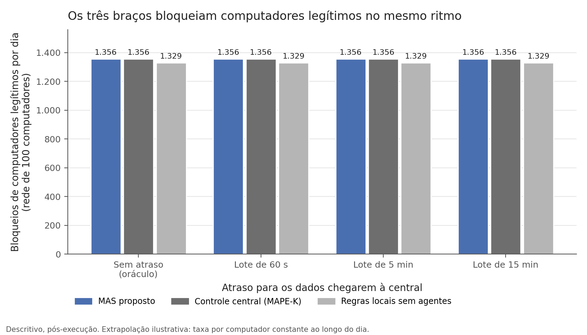
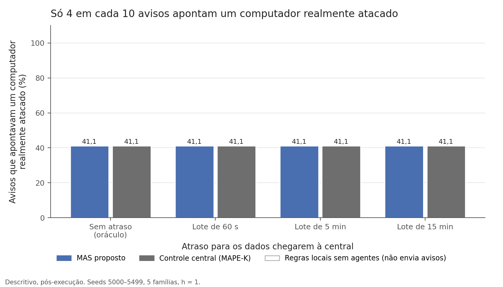
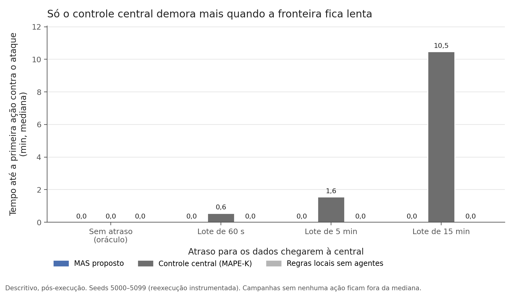
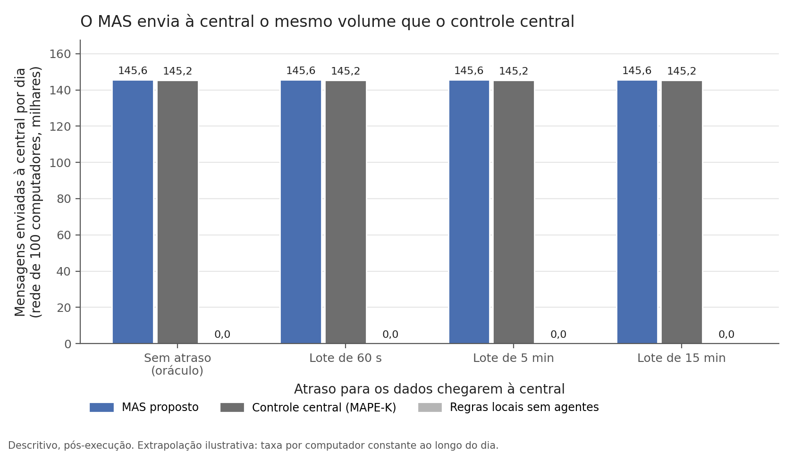
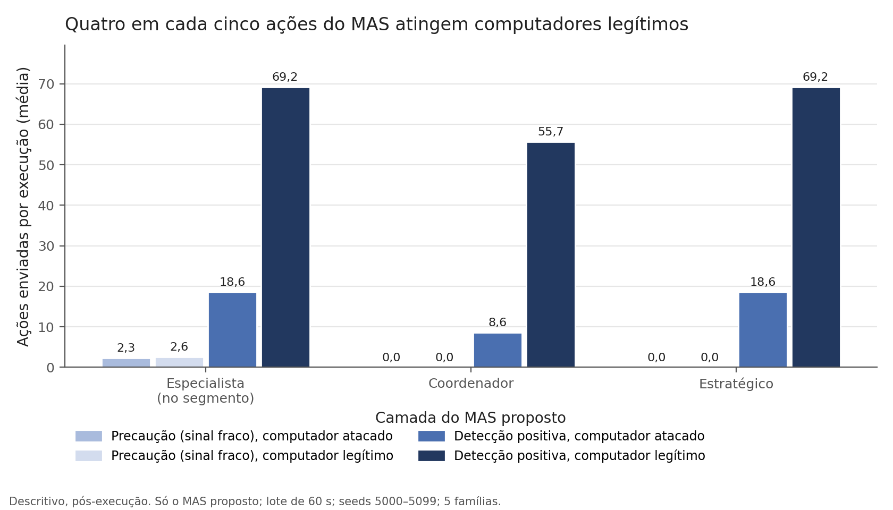

# Fase 1 — 10. Etapa 3: análise descritiva pós-execução

> **Descritivo, pós-execução.** Nada aqui é teste de hipótese. O pré-registro
> (`08_preregistro_oficial.md`), o código de simulação e os resultados confirmatórios
> (`results/fase1_oficial/raw/`, `summary.json`) **não foram alterados**. Só médias, medianas, P90
> e IC95 % por bootstrap de clusters (cluster = seed; 10 000 reamostragens para médias e razões,
> 2 000 para medianas e P90; `default_rng(0)`).

## 0. Dados, recorte e definições

**Recorte.** h = 1; as 5 famílias; braços **SN** (MAS proposto), **U1** (controle central, MAPE-K) e
**B2L** (regras locais sem agentes); 4 níveis de fronteira: oráculo, lote 60 s ("restrita"), lote
5 min e lote 15 min.

**Duas fontes:**

| Fonte | Seeds | Usada para |
|---|---|---|
| `results/fase1_oficial/raw/` (execução oficial) | 5000–5499 (500) | hosts benignos com ação por run, avisos (total, falsos, precisão), mensagens e bytes pela fronteira, primeira ação **preventiva** |
| Reexecução instrumentada (`analysis/fase1_etapa3_rerun.py`) | 5000–5099 (100) | classificação por incidente, isolados × restringidos, avisos entre segmentos, revocação do aviso, primeira ação de **qualquer** tipo, mensagens em todos os enlaces, ações por camada |

**Verificação da reexecução** (`results/fase1_oficial/etapa3/rerun/verify.json`): os 2 000 jobs
(4 níveis × 5 famílias × 100 seeds) foram rodados com o driver oficial, sem mudança de código.
As **7 137 linhas** produzidas são **idênticas** às do raw, campo a campo (texto CSV). Só depois
disso os logs foram lidos. A instrumentação apenas lê os logs e não altera o comportamento.

**Três fatos do modelo que limitam a leitura "por dia" e "por 100 hosts"** (sem mudança no pré-registro):

1. O horizonte de **dano** é 24 h, mas o **fundo benigno** só existe numa janela = duração do ataque
   ± 300 s: em média **36,5 min** por run (de 10,7 a 143,2 min). Falsos positivos e mensagens são
   gerados só nessa janela, não em 24 h.
2. Cada run tem **9 hosts benignos com telemetria** (3 por perfil E1/E2/E3), mais 1–3 hosts atacados
   (média de 10,9 hosts com eventos). Os "100 hosts" (segmentos 70/20/10) existem só no modelo de
   dano.
3. Os negativos da classificação são os incidentes benignos da verdade: os 9 hosts do fundo mais 51
   incidentes-isca da família `interleaved` (em 500 runs). Nenhuma isca recebeu ação ou detecção,
   então todo FP vem do fundo benigno. Só o VN muda (+51), e precisão, revocação e F1 ficam iguais.

**Definições.**
- *Ação de contenção*: qualquer despacho com ações (isolar, matar processo, bloquear segmento, ações
  preventivas), por precaução ou após detecção. Tempo contado a partir do **primeiro evento
  malicioso** da campanha (verdade) até a **chegada** da ação ao host.
- *Aviso*: registro `advisory` (vínculo de campanha entre dois hosts). É **verdadeiro** se o host de
  destino é atacado e **falso** se é benigno, como em `advisories_false` no raw.
- *Ação que cruzou a fronteira* (item 4): despachada fora do segmento (coordenador ou estratégico) ou
  disparada por um evento de outro segmento (aviso).

**Achado transversal.** SN e U1 produzem **as mesmas decisões**: a mesma classificação, os mesmos
hosts benignos atingidos e os mesmos avisos. Mudam só **quando** as ações chegam. Como as decisões
não dependem do atraso, os números dos itens 1 e 4 são idênticos nos 4 níveis de fronteira, com uma
exceção: a revocação do aviso cai a 15 min.

---

## 1. Falsos positivos e precisão

### 1a. Classificação por incidente (`incident_metrics.classification`)

Subconjunto de 100 seeds, 500 runs por braço. **Idêntico nos 4 níveis de fronteira** (por nível em
`summary.json` → `item1.a_classification`).

| Braço | Base | VP | FP | FN | VN | Precisão [IC95] | Revocação [IC95] | F1 [IC95] |
|---|---|---|---|---|---|---|---|---|
| SN | qualquer ação | 947 | 1582 | 0 | 2969 | 37,4 % [36,6; 38,4] | 100,0 % [100,0; 100,0] | 54,5 % [53,5; 55,5] |
| U1 | qualquer ação | 947 | 1582 | 0 | 2969 | 37,4 % [36,6; 38,4] | 100,0 % [100,0; 100,0] | 54,5 % [53,5; 55,5] |
| B2L | qualquer ação | 932 | 1548 | 15 | 3003 | 37,6 % [36,7; 38,5] | 98,4 % [97,7; 99,1] | 54,4 % [53,4; 55,4] |
| SN | ação após detecção | 797 | 772 | 150 | 3779 | 50,8 % [49,4; 52,3] | 84,2 % [82,1; 86,2] | 63,4 % [62,0; 64,8] |
| U1 | ação após detecção | 797 | 772 | 150 | 3779 | 50,8 % [49,4; 52,3] | 84,2 % [82,1; 86,2] | 63,4 % [62,0; 64,8] |
| B2L | ação após detecção | 797 | 772 | 150 | 3779 | 50,8 % [49,4; 52,3] | 84,2 % [82,1; 86,2] | 63,4 % [62,0; 64,8] |

(A base "detecção" dá exatamente os mesmos números que "ação após detecção".)

Nos três braços, de cada 10 hosts que recebem alguma ação, só cerca de 4 estavam de fato sendo
atacados. A detecção é a mesma em todos, porque usa os mesmos detectores e limiares. A precaução do
SN e do U1 alcança todos os hosts atacados (revocação de 100 %), enquanto as regras locais perdem 15
de 947. O preço disso é cerca de 2 FP a mais para cada VP ganho.

### 1b. Hosts benignos atingidos por run (9 hosts benignos, janela média de 36,5 min)

**Idêntico nos 4 níveis.**

| Braço | Com alguma ação (raw, 500 seeds) [IC95] | Isolados (100 seeds) [IC95] | Só restringidos (100 seeds) [IC95] |
|---|---|---|---|
| SN | 3,10 [3,05; 3,15] | 2,19 [2,09; 2,29] | 0,97 [0,90; 1,05] |
| U1 | 3,10 [3,05; 3,15] | 2,19 [2,09; 2,29] | 0,97 [0,90; 1,05] |
| B2L | 3,04 [2,99; 3,08] | 2,09 [2,00; 2,19] | 1,00 [0,93; 1,08] |

Em cada run, cerca de **1 em cada 3 computadores legítimos** (3,1 de 9) recebe alguma ação, e mais
de 2 deles são **isolados** da rede. Isso acontece igualmente nos três braços, então não é um defeito
do MAS. É um problema dos detectores e dos limiares congelados da Fase 1 diante do fundo benigno
(backups, varreduras administrativas, conexões de administração).

### 1c. Avisos entre segmentos (SN e U1; o B2L não emite avisos)

| Nível | Braço | Avisos/run | Verdadeiros/run | Falsos/run | Precisão [IC95] (raw) | Entre segmentos (100 seeds): total / V / F | Revocação: campanhas entre segmentos avisadas antes do impacto [IC95] |
|---|---|---|---|---|---|---|---|
| oráculo | SN | 0,487 | 0,200 | 0,287 | 41,1 % [39,0; 43,3] | 255 / 100 / 155 | 100/173 = 57,8 % [55,2; 61,0] |
| oráculo | U1 | 0,487 | 0,200 | 0,287 | 41,1 % [39,0; 43,3] | 255 / 100 / 155 | 100/173 = 57,8 % [55,2; 61,0] |
| oráculo | B2L | 0 | 0 | 0 | não se aplica | 0 / 0 / 0 | 0/173 = 0,0 % |
| 60 s | SN | 0,487 | 0,200 | 0,287 | 41,1 % [39,0; 43,3] | 255 / 100 / 155 | 100/173 = 57,8 % [55,2; 61,0] |
| 60 s | U1 | 0,487 | 0,200 | 0,287 | 41,1 % [39,0; 43,3] | 255 / 100 / 155 | 100/173 = 57,8 % [55,2; 61,0] |
| 60 s | B2L | 0 | 0 | 0 | não se aplica | 0 / 0 / 0 | 0/173 = 0,0 % |
| 5 min | SN | 0,487 | 0,200 | 0,287 | 41,1 % [39,0; 43,3] | 255 / 100 / 155 | 100/173 = 57,8 % [55,2; 61,0] |
| 5 min | U1 | 0,487 | 0,200 | 0,287 | 41,1 % [39,0; 43,3] | 255 / 100 / 155 | 100/173 = 57,8 % [55,2; 61,0] |
| 5 min | B2L | 0 | 0 | 0 | não se aplica | 0 / 0 / 0 | 0/173 = 0,0 % |
| 15 min | SN | 0,487 | 0,200 | 0,287 | 41,1 % [39,0; 43,3] | 255 / 100 / 155 | 96/173 = 55,5 % [51,7; 59,4] |
| 15 min | U1 | 0,487 | 0,200 | 0,287 | 41,1 % [39,0; 43,3] | 255 / 100 / 155 | 96/173 = 55,5 % [51,7; 59,4] |
| 15 min | B2L | 0 | 0 | 0 | não se aplica | 0 / 0 / 0 | 0/173 = 0,0 % |

Todos os avisos do raw ligam hosts de segmentos diferentes (`advisories_crossing` = `advisories`).
No raw, sobre 2 500 runs por braço, há 1 218 avisos, dos quais 718 são falsos.

**Seis em cada dez avisos são falsos.** Eles apontam um servidor legítimo que recebeu uma conexão
de administração de uma estação legítima. Mesmo assim, os avisos chegam a tempo em **58 %** das
campanhas que cruzam segmentos. Com lote de 15 min, a revocação cai para 55,5 %. SN e U1 emitem
exatamente os mesmos avisos.

### 1d. Custo operacional por dia — **extrapolação ILUSTRATIVA**

> Extrapolação linear que **assume taxas constantes por host e ao longo do dia**. A taxa por host e
> por hora vem da janela benigna de cada run (média de 36,5 min, **não 24 h**). Bloqueios e avisos
> falsos são divididos pelos 9 hosts benignos. Avisos totais e verdadeiros são divididos pelos hosts
> com eventos (média de 10,9). Depois, a taxa é multiplicada por 24 h e por N hosts. A contagem é de
> **episódios** (um mesmo host pode ser bloqueado várias vezes por dia), não de hosts distintos.
> Avisos verdadeiros dependem da frequência de ataques, que aqui é a do simulador (≥ 1 campanha por
> janela), muito acima de qualquer rede real. Nível lote 60 s; os outros níveis dão os mesmos números
> (`summary.json` → `item1.d_per_day`).

| Braço | Grandeza (por dia) | 100 hosts | 1.000 hosts | 10.000 hosts |
|---|---|---|---|---|
| SN | Bloqueios de hosts legítimos | 1.356 | 13.556 | 135.558 |
| SN | Idem, ponderado por perfil 70/20/10 (100 seeds) | 1.619 | 16.194 | 161.943 |
| SN | Avisos (total) | 162 | 1.623 | 16.225 |
| SN | Avisos verdadeiros | 67 | 666 | 6.661 |
| SN | Avisos falsos | 126 | 1.257 | 12.573 |
| U1 | Bloqueios de hosts legítimos | 1.356 | 13.556 | 135.558 |
| U1 | Idem, ponderado por perfil 70/20/10 (100 seeds) | 1.619 | 16.194 | 161.943 |
| U1 | Avisos (total) | 162 | 1.623 | 16.225 |
| U1 | Avisos verdadeiros | 67 | 666 | 6.661 |
| U1 | Avisos falsos | 126 | 1.257 | 12.573 |
| B2L | Bloqueios de hosts legítimos | 1.329 | 13.293 | 132.931 |
| B2L | Idem, ponderado por perfil 70/20/10 (100 seeds) | 1.602 | 16.018 | 160.177 |
| B2L | Avisos (total, verdadeiros, falsos) | 0 | 0 | 0 |

(As taxas de avisos total, verdadeiros e falsos usam denominadores diferentes, então "verdadeiros +
falsos" não precisa somar o total.)





Mantida a taxa observada, uma rede de 100 computadores teria cerca de **1 350 bloqueios de máquinas
legítimas por dia**, ou seja, cada máquina seria bloqueada umas 13 vezes por dia. Esse número é
ilustrativo, mas a ordem de grandeza mostra que a configuração de limiares da Fase 1 seria
inoperável num ambiente real, **em qualquer um dos três braços**. Os servidores (E2) são os mais
atingidos: 20,5 episódios por servidor por dia, contra 16,7 nas estações e 3,9 no IoT.

---

## 2. Tempo até a contenção

**Primeira ação de qualquer tipo** (100 seeds; 549 campanhas por célula). Tempos em minutos desde o
primeiro evento malicioso da campanha. "Antecedência" = impacto − primeira ação, calculada só nas
518 campanhas que têm impacto na verdade (31 não têm). Valor negativo = a ação chegou depois do
impacto.

| Nível | Braço | Campanhas | Sem nenhuma ação (não contidas) | Tempo até 1ª ação: mediana [IC95] | P90 [IC95] | Antecedência: mediana [IC95] | P90 [IC95] | 1ª ação depois do impacto |
|---|---|---|---|---|---|---|---|---|
| oráculo | SN | 549 | 0 | 0,00 [0,00; 0,00] | 6,59 [5,97; 7,45] | 9,90 [9,43; 10,18] | 79,42 [73,06; 84,80] | 8/518 |
| oráculo | U1 | 549 | 0 | 0,00 [0,00; 0,00] | 6,59 [5,97; 7,45] | 9,90 [9,43; 10,18] | 79,42 [73,06; 84,80] | 8/518 |
| oráculo | B2L | 549 | 0 | 0,00 [0,00; 0,00] | 6,59 [5,97; 7,45] | 9,90 [9,43; 10,18] | 79,42 [73,06; 84,80] | 8/518 |
| 60 s | SN | 549 | 0 | 0,00 [0,00; 0,00] | 6,59 [5,97; 7,45] | 9,90 [9,43; 10,18] | 79,42 [73,06; 84,80] | 8/518 |
| 60 s | U1 | 549 | 0 | 0,55 [0,52; 0,62] | 7,39 [6,50; 8,40] | 9,16 [8,81; 9,50] | 78,89 [72,20; 84,40] | 13/518 |
| 60 s | B2L | 549 | 0 | 0,00 [0,00; 0,00] | 6,59 [5,97; 7,45] | 9,90 [9,43; 10,18] | 79,42 [73,06; 84,80] | 8/518 |
| 5 min | SN | 549 | 0 | 0,00 [0,00; 0,00] | 6,59 [5,97; 7,45] | 9,90 [9,43; 10,18] | 79,42 [73,06; 84,80] | 8/518 |
| 5 min | U1 | 549 | 0 | 1,55 [0,94; 2,43] | 10,42 [10,39; 10,46] | 7,62 [7,13; 8,14] | 78,06 [71,93; 84,27] | 28/518 |
| 5 min | B2L | 549 | 0 | 0,00 [0,00; 0,00] | 6,59 [5,97; 7,45] | 9,90 [9,43; 10,18] | 79,42 [73,06; 84,80] | 8/518 |
| 15 min | SN | 549 | 0 | 0,00 [0,00; 0,00] | 6,59 [5,97; 7,45] | 9,90 [9,43; 10,18] | 79,42 [73,06; 84,80] | 8/518 |
| 15 min | U1 | 549 | 0 | 10,47 [10,47; 10,48] | 10,71 [10,68; 10,75] | 1,19 [0,40; 1,86] | 68,82 [63,44; 74,27] | 231/518 |
| 15 min | B2L | 549 | 0 | 0,00 [0,00; 0,00] | 6,59 [5,97; 7,45] | 9,90 [9,43; 10,18] | 79,42 [73,06; 84,80] | 8/518 |

**Primeira ação preventiva** (raw, 500 seeds, 2 760 campanhas; `first_prevention_s_any`; mesma
leitura com outra definição de "contenção").

| Nível | Braço | Nunca prevenidas | Mediana | P90 [IC95] | Antecedência: mediana | P90 | Preventiva depois do impacto |
|---|---|---|---|---|---|---|---|
| oráculo | SN | 78 | 0,00 | 6,89 [6,46; 7,36] | 9,66 | 76,70 | 0/2549 |
| oráculo | U1 | 78 | 0,00 | 6,89 [6,46; 7,36] | 9,66 | 76,70 | 0/2549 |
| oráculo | B2L | 78 | 0,00 | 8,69 [8,19; 8,93] | 9,53 | 76,70 | 0/2549 |
| 60 s | SN | 78 | 0,00 | 7,39 [6,94; 7,52] | 9,63 | 76,70 | 0/2549 |
| 60 s | U1 | 78 | 0,58 | 7,46 [7,38; 8,38] | 9,05 | 76,23 | 14/2549 |
| 60 s | B2L | 78 | 0,00 | 8,69 [8,19; 8,93] | 9,53 | 76,70 | 0/2549 |
| 5 min | SN | 78 | 0,00 | 8,33 [7,72; 8,86] | 9,55 | 76,70 | 0/2549 |
| 5 min | U1 | 78 | 1,90 | 10,43 [10,42; 10,45] | 7,45 | 76,08 | 94/2549 |
| 5 min | B2L | 78 | 0,00 | 8,69 [8,19; 8,93] | 9,53 | 76,70 | 0/2549 |
| 15 min | SN | 78 | 0,00 | 8,69 [8,19; 8,93] | 9,55 | 76,70 | 0/2549 |
| 15 min | U1 | 78 | 10,48 | 10,73 [10,71; 10,75] | 1,18 | 66,60 | 1129/2549 |
| 15 min | B2L | 78 | 0,00 | 8,69 [8,19; 8,93] | 9,53 | 76,70 | 0/2549 |



O MAS e as regras locais agem **no próprio segmento**, quase no mesmo instante do primeiro sinal
(mediana de 0,0 min, ou 0,012 s; 78,5 % das campanhas recebem a primeira ação em menos de 1 s),
qualquer que seja o atraso da fronteira. O controle central
espera o lote: com 15 min, a mediana sobe para **10,5 min**, e em **231 de 518** campanhas a
primeira ação chega **depois** do impacto, contra 8 de 518 no MAS. Entre o MAS e as regras locais
sem agentes, a primeira ação sai no mesmo tempo. A diferença aparece só nas ações preventivas que
dependem de aviso: P90 de 6,9 min contra 8,7 min no oráculo, diferença que desaparece com o lote
de 15 min.

---

## 3. Custo de comunicação

**Idêntico nos 4 níveis de fronteira**: o atraso muda quando as mensagens chegam, não quantas são.

| Braço | Msgs pela fronteira/run [IC95] (raw) | kB pela fronteira/run (raw) | Msgs em todos os enlaces/run (100 seeds) | Por enlace (100 seeds) | Msgs entre agentes/run | Msgs à central por dia, 100 hosts (ilustrativo) |
|---|---|---|---|---|---|---|
| SN | 437,1 [431,2; 443,2] | 2.297,8 | 1.333,5 | fronteira 445,2; local 444,2; coordenador→estratégico 444,2 | 888,3 | 145.565 |
| U1 | 436,1 [430,2; 442,2] | 2.297,5 | 444,2 | fronteira 444,2 | 0 | 145.240 |
| B2L | 0,0 | 0,0 | 444,2 | local 444,2 | 0 | 0 |
| **SN / U1** | **×1,002** | **×1,0001** | **×3,00** | | | |

(As médias de "fronteira" diferem entre as colunas raw e subconjunto só porque as seeds são outras.)



O MAS **mantém** o tráfego que cruza a fronteira: o especialista repassa cada evento ao
coordenador, que fica fora do segmento, e por isso as mensagens e os bytes são os mesmos do controle
central (×1,002 e ×1,0001). Somando os enlaces internos, o MAS movimenta **3 vezes** mais mensagens
que o U1, além de 888 mensagens entre agentes por run. A vantagem do MAS está em **onde a decisão é
tomada**, não em mandar menos dados à central. Só as regras locais sem agentes (B2L) não usam a
fronteira.

---

## 4. Ações por camada (só SN)

Despachos por run (média) e total em 500 runs (100 seeds × 5 famílias). Lote 60 s, **idêntico nos 4
níveis** (`summary.json` → `item4.per_level`).

| Camada | Precaução, host malicioso | Precaução, host benigno | Detecção positiva, host malicioso | Detecção positiva, host benigno | Total/run | Cruzaram a fronteira [IC95] |
|---|---|---|---|---|---|---|
| Especialista | 2,25 (1127) | 2,58 (1291) | 18,58 (9289) | 69,16 (34581) | 92,58 (46288) | 0,6 % [0,5; 0,6] |
| Coordenador | 0 | 0 | 8,58 (4289) | 55,65 (27827) | 64,23 (32116) | 100,0 % |
| Estratégico | 0 | 0 | 18,58 (9289) | 69,16 (34581) | 87,74 (43870) | 100,0 % |
| **Todas** | | | | | **244,55** | **62,4 % [61,7; 62,9]** |



**Quatro em cada cinco** despachos do MAS (98 280 de 122 274, 80,4 %) atingem computadores
legítimos. Quase todos vêm de uma detecção positiva, não de precaução: a precaução por sinal fraco
responde por só 2 % dos despachos. O estratégico repete cada decisão positiva do especialista (os
números são idênticos) e o coordenador repete a maioria. Por isso, **62 % dos despachos vêm de fora
do segmento**, embora a primeira ação seja sempre local. As camadas superiores **reforçam** decisões
que o especialista já tomou, mais do que acrescentam decisões novas.

---

## O que isto muda nas conclusões

1. A precisão da contenção é baixa **nos três braços**: 37,4 % (cerca de 3,1 de 9 computadores
   legítimos atingidos por run, mais de 2 deles isolados). Isso **enfraquece a aplicabilidade prática
   de todo o sistema** com os limiares da Fase 1, mas não muda a comparação entre arquiteturas,
   porque o MAS não erra mais que o controle central (números idênticos).
2. A coordenação entre segmentos tem um custo que os testes confirmatórios não mediam: **59 % dos
   avisos são falsos** (precisão de 41,1 %), para avisar a tempo 57,8 % das campanhas que cruzam
   segmentos. Isso **enfraquece** a leitura de H1 como ganho "limpo" de coordenação.
3. A localidade se confirma no tempo: com lote de 15 min, a mediana até a primeira ação é **0,0 min**
   no MAS e **10,5 min** no controle central, que age depois do impacto em 231 de 518 campanhas. Isso
   **reforça** a explicação de H3 e H4.
4. O MAS **não reduz** o tráfego que cruza a fronteira: ×1,002 mensagens e o mesmo volume em bytes
   que o controle central, com 3× mais mensagens no total. Isso **enfraquece** qualquer argumento de
   economia de comunicação a favor da proposta.
5. Em 62,4 % dos despachos do MAS, coordenador e estratégico repetem decisões do especialista. A
   camada hierárquica, como configurada, **acrescenta pouco à decisão** e cria redundância, o que
   pede um papel mais claro para ela nas próximas fases.

---

### Reprodução

```bash
python3 analysis/fase1_etapa3_rerun.py --seeds 5000-5099   # reexecução + verificação contra o raw (≈ 10 min, 10 núcleos)
python3 analysis/fase1_etapa3.py                           # summary.json + 5 figuras
```

Arquivos: `results/fase1_oficial/etapa3/summary.json` (todos os números, por nível e braço),
`rerun/verify.json` (verificação byte a byte), `rerun/extras.jsonl.gz` (métricas extras por run e
braço), `scenario_meta.csv` (janela benigna e hosts com telemetria, 2 500 cenários), `figs/` (PNG,
200 dpi).
