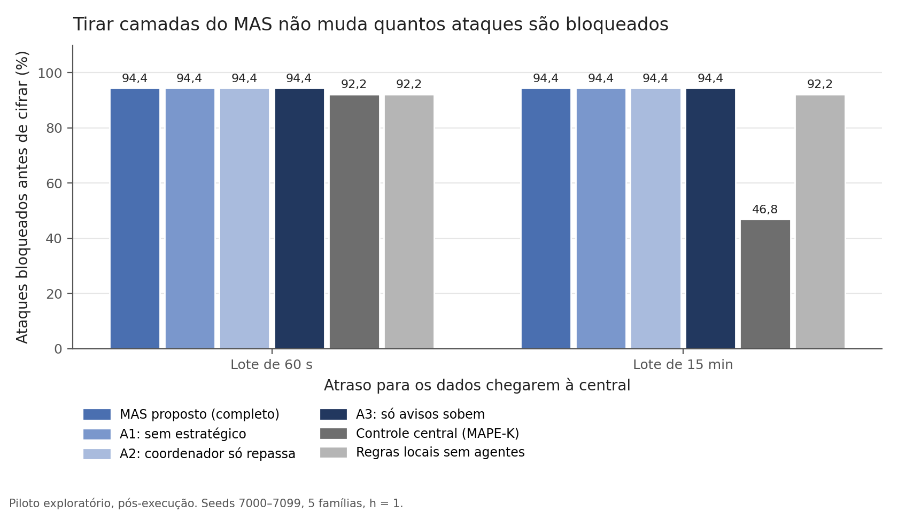
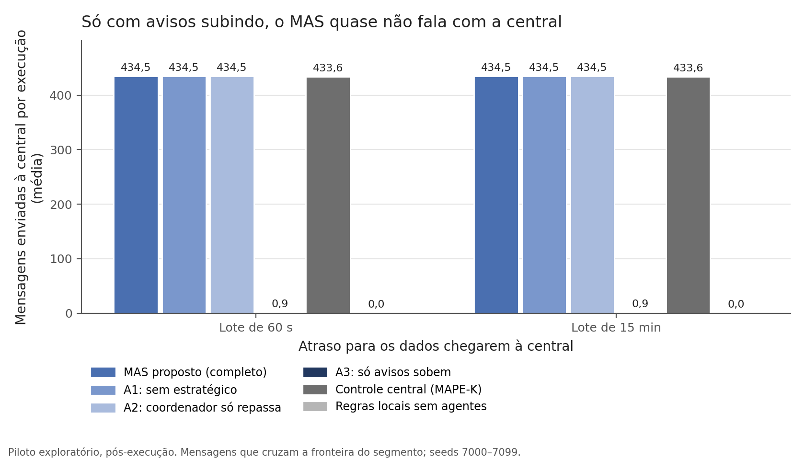

# Fase 1 — 11. Etapa 3b: ablação da hierarquia do MAS (piloto EXPLORATORY)

Status: **EXPLORATORY.** As seções 1 a 5 (desenho e leitura declarada) foram escritas e comitadas
**antes** de rodar o piloto; o hash desse commit está em `results/fase1_ablacao/manifest.json`
(campo `commit` de cada bloco). A seção 6 (resultados) foi acrescentada depois, num commit separado.
Nada do pré-registro oficial (`08_preregistro_oficial.md`), dos resultados confirmatórios
(`results/fase1_oficial/`) ou do comportamento padrão muda.

**Motivação** (`10_etapa3_descritiva.md`, item 4 e item 3): o estratégico repete todas as decisões
positivas do especialista; o coordenador repete a maioria; 62,4 % dos despachos do SN vêm de fora do
segmento; e o SN manda pela fronteira o mesmo tráfego que o U1 (×1,002 mensagens).

## 1. Variantes do braço SN

Toda variante é um conjunto de **knobs novos, desligados por padrão** (valor padrão = comportamento
atual), aplicados como políticas de Knowledge e no transporte:

| Knob | Onde | Padrão | Efeito |
|---|---|---|---|
| política `sn_layers` ∈ {`full`, `no_strategic`, `specialist_only`} | `graph/build_sn_graph.py:73-96` (leitura e validação), `:132-172` (`_build_ablated`) | `full` | remove o nó estratégico (`no_strategic`) ou coordenadores + estratégico (`specialist_only`) do grafo |
| `Transport(..., sn_layers=...)` | `simulation/transport.py:157`, `:168`, `:189-191`, `:294` | `full` | corta o caminho do evento no SN após o coordenador (2 saltos) ou após o especialista (1 salto) |
| política existente `dispatch_on_flag::coordinator` | `agents/mape.py:104` (padrão True), lida em `agents/domain_coordinator.py:156` | True | False = o coordenador não despacha ações com veredito positivo |

O grafo recusa rodar se a política e o transporte divergirem (`graph/build_sn_graph.py:89-90`).
Com `sn_layers = full` o código executado é o mesmo de antes (o ramo novo só é tomado com outro valor);
a regressão R inteira (Fases 8, 1, 1b e oficial: `tests/test_fase1_phase8_regression.py`,
`tests/test_fase1b.py`, `tests/test_fase1_oficial.py`, mais `tests/test_fase1.py` e
`tests/test_graph_construction.py`) passou: **106 testes**, incluindo a reprodução byte a byte das
linhas do piloto 1b pelo driver oficial. O braço SN do novo driver reproduz exatamente o SN oficial
(`tests/test_fase1_ablacao.py::test_sn_arm_equals_the_official_sn_arm`).

### A1 — "sem estratégico"

`sn_layers = no_strategic`. O grafo termina nos coordenadores (`graph/build_sn_graph.py:161-164`); o
transporte não tem o salto coordenador → estratégico (enlace `site`).

**Ações que só o estratégico executava** (autoridade: `agents/mape.py:79-83` + `agents/mitigation.py:98-102`;
o especialista tem `LOCAL_PHASES` = contenção, erradicação, `prevent_host`, `prevent_segment`,
`agents/segment_specialist.py:35`; o coordenador tem contenção, erradicação, `prevent_host`,
`prevent_segment`):

| Ação | Fase | O que faz no modelo de dano | Por que só o estratégico |
|---|---|---|---|
| `trigger_backup_restore(incidente)` | `recovery` (`agents/mitigation.py:65,69,224`) | restaura a fração restaurável dos arquivos cifrados no host após `restore_delay_s` (`simulation/damage_model.py:60-64`); com inibição de recuperação, fração 0,43 | só o estratégico tem a fase `recovery` |
| `segment_network(segment@h…)` | `prevent_global` (`agents/mitigation.py:103-104,251`) | bloqueia saltos laterais com probabilidade e enquanto ativo (`simulation/damage_model.py:86-87`); na 1b com escopo dos segmentos da campanha conhecida (`segment_network_scope = incident_segments`, `simulation/fase1b_experiments.py:43`; alvos em `agents/mape.py:319-321`, via `repository.campaign_hosts`, alimentado por `link_hosts` em `agents/segment_specialist.py:145`) | só o estratégico tem `prevent_global` |

Inventário empírico (SN, lote 60 s, 5 famílias, seeds 7000–7009; **só tipos de ação por camada,
nenhum desfecho foi calculado**): as únicas ações que aparecem apenas no estratégico são essas duas
(662 `segment_network` e 3 012 `trigger_backup_restore` em 50 runs). O coordenador tem uma exclusiva
de rótulo, `block_network_segment(<domínio>)`, mas o modelo de dano aplica qualquer
`block_network_segment` ao segmento do host que disparou o despacho (`simulation/damage_model.py:51-55`),
o mesmo efeito do bloqueio do especialista.

**Confirmação de que deixam de existir:** em A1, A2 e A3 não há registro da camada estratégica, nem
`trigger_backup_restore` nem `segment_network` em nenhum despacho, nem tráfego no enlace `site`
(`tests/test_fase1_ablacao.py::test_no_strategic_and_its_actions_disappear`). **Não são transferidas**
para outra camada: a autoridade do especialista e do coordenador não muda. O piloto também conta os
rótulos por camada em cada run (`extras/*.jsonl.gz`, campo `action_names`) para confirmar.

### A2 — "coordenador só repassa"

A1 + `dispatch_on_flag::coordinator = False`. Com isso o coordenador nunca despacha
(`agents/domain_coordinator.py:154-201`): veredito positivo → só `escalate_to_strategic` sem ações;
escalada sem veredito → nada, porque o braço SN da 1b já usa `coordinator_precaution = "none"`
(`agents/domain_coordinator.py:175`, `simulation/fase1b_experiments.py:58`). O coordenador continua
recebendo todos os eventos (o tráfego pela fronteira é o mesmo do SN,
`test_a2_keeps_the_coordinator_and_the_telemetry_uplink`) e continua sendo o **relé dos avisos**.

- **Avisos.** No código atual o vínculo e o aviso já são do especialista: o especialista de origem
  detecta o vínculo (`agents/segment_specialist.py:139-147`, regra em `agents/campaign_links.py:34-45`)
  e chama o especialista do host avisado (`receive_advisory`, `agents/segment_specialist.py:62-80`),
  que aplica a ação no próprio segmento (`isolate_host(B)` + `restrict_share_write(B)`,
  `agents/campaign_links.py:48-52`). O coordenador entra só no **tempo** do aviso: subida pela
  fronteira (lote, banda, fila compartilhada com a telemetria), serviço do coordenador, descida
  (`graph/build_sn_graph.py:49-70`). Logo, em A2 **todas** as ações são dos especialistas, inclusive a
  do host avisado, sem mudar nada no especialista.
- **Exemplo pedido (protect_backup no E2):** `protect_backup` já está na autoridade do especialista
  (`prevent_segment` ∈ `LOCAL_PHASES`) e o especialista E2 o despacha quando o seu detector dispara
  (2 295 vezes no inventário acima). A ação do **aviso** não inclui `protect_backup` (é a regra de
  precaução de `advisory_actions`), e não foi acrescentada: isso mudaria o comportamento do
  especialista, não só o roteamento.
- Artefato de log: o coordenador ainda grava `message_sent` "to strategic"
  (`agents/domain_coordinator.py:280`), embora não haja estratégico. É só registro; as mensagens são
  medidas pelo transporte (`Transport.crossings`), que não conta esse salto.

### A3 — "só avisos sobem"

A2 + `sn_layers = specialist_only`: o grafo termina no especialista (`graph/build_sn_graph.py:157-159`),
o transporte não leva o evento ao coordenador (1 salto, enlace `local`). Não há coordenador nem
estratégico no grafo; o relé do aviso continua modelado em `advisory_timing`
(`graph/build_sn_graph.py:49-70`): **2 travessias da fronteira por aviso entre segmentos** (subida e
descida, 256 B cada, `ADVISORY_BYTES`), e nada mais
(`tests/test_fase1_ablacao.py::test_a3_only_advisories_cross_the_boundary`).

**O que mais é estritamente necessário para o vínculo de campanha funcionar: nada.**
- A regra de vínculo usa só eventos do host de origem A, que o especialista do segmento de A já
  recebe: `peer_hosts` do evento de A e o fato de A ter ≥ 1 sinal na visão do nó
  (`agents/campaign_links.py:34-45`), sobre o histórico local do especialista
  (`agents/segment_specialist.py:90-91`). Nenhum dado de outro segmento entra na regra.
- O aviso carrega `from_host`, `to_host` e `event_id` (`agents/segment_specialist.py:74-75`); isso
  basta para o especialista de B agir.
- Em A3 **não sobem**: os relatórios por evento do especialista (`message_sent` ao coordenador,
  `agents/segment_specialist.py:137-138`) e a telemetria bruta. As escritas no Knowledge compartilhado
  (`record_event`, `link_hosts`) continuam acontecendo no simulador, mas ninguém fora do segmento as lê
  em A3 (o único leitor de `link_hosts` era o estratégico, via `campaign_hosts`); elas não são tráfego
  no modelo de transporte, nem antes nem agora.
- Os mesmos pares (A, B) são avisados em SN, A2 e A3 (`test_a2_and_a3_advise_the_same_hosts`). O que
  pode mudar é o **tempo**: em A3 a fila da subida só tem avisos, sem telemetria.

**Nenhuma variante exigiu mudar algo além do roteamento (grafo e transporte) e da autoridade das
camadas (remover o estratégico; desligar o despacho do coordenador).**

## 2. Leitura declarada (antes de rodar)

Δ = variante − SN, pareado por campanha (família, seed, campanha), mesmo nível de fronteira.
p = proporção de campanhas contidas antes do impacto (`contained_before_impact`). IC95 % por bootstrap
de clusters (cluster = seed; 10 000 reamostragens; `default_rng(0)`), como na fase oficial.
`data_loss_per_host` em arquivos/host; Δ perda > 0 = pior.

Veredito **por variante e por nível** (lote 60 s e lote 15 min):

| Veredito | Regra |
|---|---|
| **Camada dispensável para proteção** | IC95 % de Δp **inteiro** em [−1; +1] pp **e** \|Δ `data_loss_per_host`\| ≤ 1 000 arquivos/host (estimativa pontual) |
| **Camada necessária** | Δp ≤ −1 pp **com** limite superior do IC95 % < 0, **ou** Δ `data_loss_per_host` > +1 000 arquivos/host (estimativa pontual) |
| **Ambíguo** | qualquer outro caso |

- **Veredito geral da variante:** "dispensável" se dispensável nos dois níveis; "necessária" se
  necessária em pelo menos um; senão "ambíguo".
- **Mecanismo** (a indicar se "necessária"): o candidato é a ação perdida — em A1, a
  **restauração** (`trigger_backup_restore`, perda) e/ou a **segmentação com escopo**
  (`segment_network`, contenção de saltos laterais); em A2, as ações do coordenador (que repetem as do
  especialista, mais tarde); em A3 (vs. A2), só o tempo dos avisos. A atribuição será feita olhando os
  rótulos perdidos e onde o Δ aparece (perda × proporção contida; famílias com movimento lateral).
- **Tráfego (só A3):** "redução relevante" se as mensagens que cruzam a fronteira por run (média,
  `crossings_boundary`) caírem ≥ 50 % em relação ao SN, em cada nível (estimativa pontual da razão
  A3/SN ≤ 0,50). Reportado também em bytes.
- **Descritivo extra (sem regra):** Δp(A3 − U1) e Δp(A3 − B2L) nos dois níveis, nas 5 famílias e em
  `campaign_e1_e2` (recorte de H1), para ver se a versão enxuta mantém as vantagens de H1 (sobre B2L)
  e de H4 (sobre U1, crescendo com o lote).

**Expectativas (não são regras):** A1 "necessária" pela perda (sem restauração); A2 ≈ A1 em proteção;
A3 ≈ A2 em proteção e "redução relevante" de tráfego (só avisos sobem).

## 3. Execução do piloto

| Item | Valor |
|---|---|
| Braços | SN, A1, A2, A3, U1, B2L (mesmas seeds, pareados) |
| Condições | h = 1; 5 famílias; fronteira lote 60 s (`restricted`) e lote 15 min (`batch15m`) |
| Seeds | **7000–7099** (100) |
| Blocos | um por (nível, família), `campaign_multihost` em 2 metades → 12 blocos de ≤ 5 min, com checkpoint por sha256 no manifest |
| Driver | `simulation/fase1_ablacao_experiments.py` (`run-all`) |
| Saída | `results/fase1_ablacao/raw/*.csv` (mesmas colunas da fase oficial), `extras/*.jsonl.gz`, `manifest.json` |

**Seeds sem sobreposição.** Faixas usadas antes (`08_preregistro_oficial.md` §4, mais as posteriores):
0–29, 0–99, 100–119, 200–209, 300–399, 1000–1199, 2000–2199, 3000–3199, 4000–4199, 5000–5499 (oficial;
5000–5099 reexecutadas na Etapa 3), 7 e 42. A maior é 5499; **7000–7099 não foi usada**
(`tests/test_fase1_ablacao.py::test_seeds_are_disjoint_from_every_previous_range`). Única exceção
declarada: o inventário de tipos de ação da §1 (seeds 7000–7009, só SN, sem desfecho).

## 4. Saída (descritiva, sem testes de hipótese)

Por braço e nível: % de campanhas contidas antes do impacto; perda de arquivos por host;
indisponibilidade; hosts legítimos atingidos por run; avisos (total, falsos, revocação); mensagens e
bytes pela fronteira; mensagens totais (todos os enlaces do transporte); despachos por camada; mediana
e P90 do tempo até a primeira ação. Δ de cada variante vs. SN com IC95 % e veredito; Δ(A3 − U1) e
Δ(A3 − B2L). Dois gráficos em `results/fase1_ablacao/figs/`. Análise:
`analysis/fase1_ablacao.py` → `results/fase1_ablacao/summary.json`.

## 5. Limitações declaradas

- Piloto **exploratório**, 100 seeds, um só modelo; os vereditos não confirmam nada.
- O SN e as variantes têm as mesmas regras e limiares da Fase 1 (precisão baixa, `10_etapa3_descritiva.md` §1).
- A2/A3 retiram camadas, mas não dão ao especialista nada que ele não tivesse; uma variante que
  **transfira** a restauração para o especialista seria outra pergunta (não testada aqui).
- A ordem das variantes é cumulativa (A3 ⊃ A2 ⊃ A1): o Δ de A2 e A3 vs. SN inclui a remoção do
  estratégico.

## 6. Resultados (piloto, pós-execução)

Execução: 12 blocos, `run-all` em 10 min 53 s de relógio (soma dos blocos 652,6 s; o maior, 103 s),
todos no commit `57427b5` (o do desenho e da leitura declarada). 553 campanhas por braço e nível
(100 seeds × 5 famílias). IC95 % por bootstrap de clusters (seed, 10 000; quantis 2 000).

### 6.1 Por braço e nível

| Nível | Braço | Contidos antes do impacto % [IC95] | Perda (arq./host) [IC95] | Indisp. % | Hosts legítimos atingidos/run | Avisos/run (falsos) | Revocação do aviso | Msgs pela fronteira/run | kB pela fronteira/run | Msgs totais/run | Despachos/run: esp. / coord. / estrat. / central | 1ª ação: mediana / P90 (min) |
|---|---|---|---|---|---|---|---|---|---|---|---|---|
| 60 s | SN | 94,4 [92,5; 96,2] | 2.400 [1.424; 3.559] | 29,13 | 3,09 | 0,452 (0,252) | 55,6 % | 434,5 | 2.286,3 | 1.301,6 | 89,1 / 58,9 / 84,4 / 0,0 | 0,00 / 7,06 |
| 60 s | A1 | 94,4 [92,5; 96,2] | 2.400 [1.424; 3.559] | 28,95 | 3,09 | 0,452 (0,252) | 55,6 % | 434,5 | 2.286,3 | 868,0 | 89,1 / 58,9 / 0,0 / 0,0 | 0,00 / 7,06 |
| 60 s | A2 | 94,4 [92,5; 96,2] | 2.400 [1.424; 3.559] | 28,95 | 3,09 | 0,452 (0,252) | 55,6 % | 434,5 | 2.286,3 | 868,0 | 89,1 / 0,0 / 0,0 / 0,0 | 0,00 / 7,06 |
| 60 s | A3 | 94,4 [92,5; 96,2] | 2.400 [1.424; 3.559] | 28,95 | 3,09 | 0,452 (0,252) | 55,6 % | 0,9 | 0,2 | 434,5 | 89,1 / 0,0 / 0,0 / 0,0 | 0,00 / 7,06 |
| 60 s | U1 | 92,2 [90,1; 94,2] | 3.540 [2.319; 4.902] | 29,12 | 3,09 | 0,452 (0,252) | 55,6 % | 433,6 | 2.286,1 | 433,6 | 0,0 / 0,0 / 0,0 / 89,1 | 0,55 / 7,59 |
| 60 s | B2L | 92,2 [90,2; 94,1] | 3.103 [1.958; 4.447] | 28,74 | 3,04 | 0,000 (0,000) | — | 0,0 | 0,0 | 433,6 | 0,0 / 0,0 / 0,0 / 0,0 | 0,00 / 7,06 |
| 15 min | SN | 94,4 [92,5; 96,2] | 2.491 [1.503; 3.682] | 29,12 | 3,09 | 0,452 (0,252) | 51,7 % | 434,5 | 2.286,3 | 1.301,6 | 89,1 / 58,9 / 84,4 / 0,0 | 0,00 / 7,06 |
| 15 min | A1 | 94,4 [92,5; 96,2] | 2.491 [1.503; 3.682] | 28,95 | 3,09 | 0,452 (0,252) | 51,7 % | 434,5 | 2.286,3 | 868,0 | 89,1 / 58,9 / 0,0 / 0,0 | 0,00 / 7,06 |
| 15 min | A2 | 94,4 [92,5; 96,2] | 2.491 [1.503; 3.682] | 28,95 | 3,09 | 0,452 (0,252) | 51,7 % | 434,5 | 2.286,3 | 868,0 | 89,1 / 0,0 / 0,0 / 0,0 | 0,00 / 7,06 |
| 15 min | A3 | 94,4 [92,5; 96,2] | 2.491 [1.503; 3.682] | 28,95 | 3,09 | 0,452 (0,252) | 52,2 % | 0,9 | 0,2 | 434,5 | 89,1 / 0,0 / 0,0 / 0,0 | 0,00 / 7,06 |
| 15 min | U1 | 46,8 [43,9; 49,8] | 11.351 [9.855; 12.952] | 28,97 | 3,09 | 0,452 (0,252) | 51,7 % | 433,6 | 2.286,1 | 433,6 | 0,0 / 0,0 / 0,0 / 89,1 | 10,48 / 10,73 |
| 15 min | B2L | 92,2 [90,2; 94,1] | 3.103 [1.958; 4.447] | 28,74 | 3,04 | 0,000 (0,000) | — | 0,0 | 0,0 | 433,6 | 0,0 / 0,0 / 0,0 / 0,0 | 0,00 / 7,06 |

Avisos, revocação, despachos e tempo até a primeira ação vêm de `extras/`; o resto, de `raw/`.
"Msgs totais" = todas as travessias de enlace do transporte (local, fronteira, coordenador →
estratégico).

**As ações exclusivas do estratégico deixaram de existir.** Rótulos `trigger_backup_restore` /
`segment_network` despachados em 500 runs: SN 28 278 / 10 031; A1, A2 e A3 0 / 0 (nos dois níveis;
`summary.json` → `per_arm.*.strategic_only_labels`). Nenhuma outra camada passou a emiti-las.

### 6.2 Δ de cada variante em relação ao SN e veredito (regra da §2)

| Variante | Nível | Δp (pp) [IC95] | Pares discordantes (+/−) | Δ perda (arq./host) [IC95] | Δ indisp. (pp) | Veredito |
|---|---|---|---|---|---|---|
| A1 | 60 s | 0,00 [0,00; 0,00] | 0 / 0 | 0 [0; 0] | -0,18 | **dispensável** |
| A1 | 15 min | 0,00 [0,00; 0,00] | 0 / 0 | 0 [0; 0] | -0,17 | **dispensável** |
| A2 | 60 s | 0,00 [0,00; 0,00] | 0 / 0 | 0 [0; 0] | -0,18 | **dispensável** |
| A2 | 15 min | 0,00 [0,00; 0,00] | 0 / 0 | 0 [0; 0] | -0,17 | **dispensável** |
| A3 | 60 s | 0,00 [0,00; 0,00] | 0 / 0 | 0 [0; 0] | -0,18 | **dispensável** |
| A3 | 15 min | 0,00 [0,00; 0,00] | 0 / 0 | 0 [0; 0] | -0,17 | **dispensável** |

**Veredito geral: A1, A2 e A3 — "camada dispensável para proteção".** Os Δ não são só pequenos: são
**zero exato**, sem nenhum par discordante, e a perda por host é idêntica campanha a campanha.

**Tráfego (só A3)** — razão A3/SN das mensagens pela fronteira por run:

| Nível | A3/SN (mensagens) [IC95] | Redução | A3/SN (bytes) | Veredito |
|---|---|---|---|---|
| 60 s | 0,21 % [0,18; 0,23] | 99,8 % | 0,010 % | **redução relevante** |
| 15 min | 0,21 % [0,18; 0,23] | 99,8 % | 0,010 % | **redução relevante** |

Em A3 só sobem os avisos: 0,9 mensagem por run (2 por aviso entre segmentos), contra 434,5 no SN. O
total de mensagens em todos os enlaces cai de 1 301,6 para 434,5 por run (−67 %), o mesmo nível do
U1 (433,6) e do B2L (433,6).

### 6.3 A versão enxuta mantém as vantagens de H1 e H4?

| Nível | Comparação | Recorte | Δp (pp) [IC95] | Discordantes (+/−) | Δ perda (arq./host) |
|---|---|---|---|---|---|
| 60 s | A3 − U1 | 5 famílias | 2,17 [1,08; 3,42] | 12 / 0 | -1.140 |
| 60 s | A3 − U1 | campaign_e1_e2 | 1,00 [0,00; 3,00] | 1 / 0 | -250 |
| 60 s | SN − U1 | 5 famílias | 2,17 [1,08; 3,42] | 12 / 0 | -1.140 |
| 60 s | SN − U1 | campaign_e1_e2 | 1,00 [0,00; 3,00] | 1 / 0 | -250 |
| 60 s | A3 − B2L | 5 famílias | 2,17 [1,08; 3,41] | 12 / 0 | -703 |
| 60 s | A3 − B2L | campaign_e1_e2 | 12,00 [6,00; 19,00] | 12 / 0 | -3.889 |
| 60 s | SN − B2L | 5 famílias | 2,17 [1,08; 3,41] | 12 / 0 | -703 |
| 60 s | SN − B2L | campaign_e1_e2 | 12,00 [6,00; 19,00] | 12 / 0 | -3.889 |
| 15 min | A3 − U1 | 5 famílias | 47,56 [44,60; 50,45] | 263 / 0 | -8.861 |
| 15 min | A3 − U1 | campaign_e1_e2 | 31,00 [22,00; 40,00] | 31 / 0 | -11.759 |
| 15 min | SN − U1 | 5 famílias | 47,56 [44,60; 50,45] | 263 / 0 | -8.861 |
| 15 min | SN − U1 | campaign_e1_e2 | 31,00 [22,00; 40,00] | 31 / 0 | -11.759 |
| 15 min | A3 − B2L | 5 famílias | 2,17 [1,08; 3,41] | 12 / 0 | -613 |
| 15 min | A3 − B2L | campaign_e1_e2 | 12,00 [6,00; 19,00] | 12 / 0 | -3.389 |
| 15 min | SN − B2L | 5 famílias | 2,17 [1,08; 3,41] | 12 / 0 | -613 |
| 15 min | SN − B2L | campaign_e1_e2 | 12,00 [6,00; 19,00] | 12 / 0 | -3.389 |

A3 e SN dão **exatamente** os mesmos Δ contra U1 e B2L. A vantagem tipo H1 em `campaign_e1_e2`
(+12 pp sobre B2L, 12 pares a favor, 0 contra) e a tipo H4 (+2,2 pp sobre U1 com lote de 60 s,
+47,6 pp com lote de 15 min) ficam intactas.

### 6.4 Mecanismo: por que o estratégico não faz falta aqui

- **Restauração (`trigger_backup_restore`).** No SN, das 31 campanhas que chegaram a cifrar (lote
  60 s), **nenhuma** teve arquivo restaurado (perda = cifrados em todas). Inspeção de um caso por família
  (seeds 7005, 7009, 7019, 7030): nenhum `trigger_backup_restore` chegou a um incidente dessas
  campanhas. Elas cifram hosts em que o detector não dispara: IoT (E3) sem telemetria de host em
  `interleaved`, `split_visibility_late_confirm` e `encryption_stream`, e o servidor E2 de
  `campaign_e1_e2`, que cifra antes de qualquer veredito positivo (26 das 31). A restauração só é
  pedida com o ataque já flagrado em estágio "late" (`recovery_min_stage`), e nesses casos a contenção
  local já impediu o impacto. Logo, os 28 278 pedidos só servem a campanhas já contidas antes do
  impacto ou a hosts legítimos com falso positivo (inferência: verificado que nenhum chegou às 4
  campanhas inspecionadas e que nenhum arquivo foi restaurado nas 31; o destino de cada pedido não foi
  tabulado). (No U1, por agir mais tarde, a restauração recuperou 4 873 de 17,8 milhões de
  arquivos em 4 campanhas — também desprezível.)
- **Segmentação com escopo (`segment_network`).** Não mudou nenhuma campanha (0 pares discordantes).
  Removê-la só **reduz** a indisponibilidade em 0,17–0,18 pp, porque deixa de bloquear tráfego legítimo.
- **Coordenador.** Ele roda o mesmo detector, com os mesmos limiares, sobre o mesmo histórico (um
  incidente é um host, e um host está num só segmento), e as ações dele chegam depois das do
  especialista. Desligá-las (A2) não muda nada.
- **Telemetria subindo.** Só servia ao coordenador e ao estratégico. Sem ela (A3), os avisos
  continuam iguais (mesmos pares, mesma precisão). Com lote de 15 min a revocação do aviso sobe um
  pouco (51,7 % → 52,2 %), porque a fila da subida deixa de ser compartilhada com a telemetria.

### 6.5 Leitura

1. As três camadas acima do especialista são **dispensáveis para proteção neste modelo**: A1, A2 e A3
   têm Δ = 0,00 pp [0,00; 0,00] e Δ perda = 0 nos dois níveis, com 0 pares discordantes.
2. A versão enxuta (A3) corta **99,8 %** das mensagens pela fronteira (434,5 → 0,9 por run) e 67 % do
   total, sem perder nada: mantém +12 pp sobre as regras locais em `campaign_e1_e2` e +47,6 pp sobre o
   controle central com lote de 15 min.
3. Isso **enfraquece a hierarquia de três camadas como desenhada**: no SN, o que protege é o
   especialista local mais o aviso entre segmentos; coordenador e estratégico só repetem decisões, e o
   único poder exclusivo deles (restaurar backup, segmentar) não alcança os ataques que escapam.
4. O resultado é do modelo, não uma prova geral. A restauração não tem efeito porque os ataques que
   cifram são justamente os que nenhum detector vê (IoT sem telemetria, servidor cifrado antes do
   veredito). Uma camada superior com sinal próprio sobre esses hosts poderia mudar isso, e não foi
   testada.
5. Passo seguinte natural (não executado): adotar A3 como braço "MAS" de uma próxima fase confirmatória
   ou testar uma variante em que o especialista assuma a restauração. As duas exigem pré-registro novo.

**Tempo total gasto na Etapa 3b:** ≈ 45 min de ponta a ponta (≈ 06:35–07:20, horário local, incluindo
uma pausa de ≈ 5 min para o `/doctor`). Desses, 10 min 53 s foram de simulação (10 núcleos) e ≈ 1 min
de regressão (106 + 13 testes).

