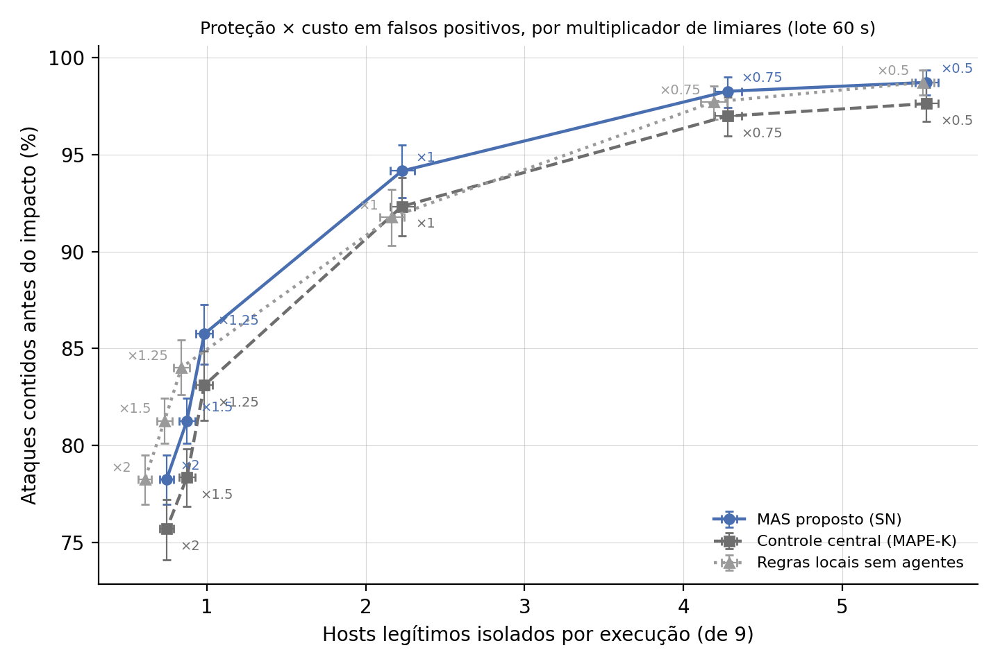

# Fase 1 — 15. Relatório do caminho A (submissão AINA)

> **E1 CONFIRMATÓRIO, E2 DESCRITIVO.** Pré-registro: `docs/fase1/14_preregistro_A.md`, congelado em
> **2026-11-17T20:00:19Z**, commit `dca68d7` (`14_preregistro_A.freeze.json`, comitado em `f6aadbc`). Todos
> os 94 blocos rodaram no commit `f6aadbc`, que é `dca68d7` mais o arquivo de congelamento. A hipótese
> vem do piloto EXPLORATORY de ablação (`11_ablacao.md`).

- **Dados:** `results/fase1_A/raw/` (94 blocos), `extras/`, `manifest.json` (sha256, commit, comando e
  tempo de cada bloco).
- **Análise:** `python3 analysis/fase1_A.py` → `results/fase1_A/summary.json` e
  `results/fase1_A/figs/E2_protecao_vs_isolados.{png,pdf}`.
- **IC:** bootstrap de clusters (cluster = seed; 10 000 reamostragens para médias e razões, 2 000 para
  quantis; `default_rng(0)`).

## Pré-condições

| Teste | Resultado |
|---|---|
| R1, regressão completa | rodada em 2026-11-17 sobre o código existente: todos os testes passam, exceto a falha conhecida declarada (`test_phase4b.py::test_playbook_v1_is_unchanged_and_default`). Os testes longos da Fase 7b rodaram em segundo plano e passaram. Nenhum arquivo existente mudou desde `8d5d08e`; não foi refeita |
| R2, golden e testes do código novo | 11 de 11 passam (`tests/test_fase1_A.py`), mais os 13 da ablação; o E1 reproduz byte a byte as linhas da ablação (seed 7000), e o E2 com m = 1,0 reproduz as linhas oficiais (seed 5000) |

## E1 — Ablação confirmatória: SN × A3 (seeds 8000–8499, 5 famílias, h = 1)

### H5 (equivalência, TOST, m = 1 pp; interseção-união nos dois níveis)

| Fronteira | Campanhas | p(SN) | p(A3) | Δ = A3 − SN | IC95 % | IC90 % | p_TOST (±1 pp) | p_TOST (±2 pp) | Pares discordantes (A3 contém e SN não / SN contém e A3 não) | Leitura |
|---|---|---|---|---|---|---|---|---|---|---|
| lote 60 s | 2 745 | 93,73 % | 93,66 % | **−0,07 pp** | [−0,18; 0,00] | [−0,18; 0,00] | **1,0 × 10⁻⁴** | 1,0 × 10⁻⁴ | 0 / 2 | equivalente |
| lote 15 min | 2 745 | 93,73 % | 93,66 % | **−0,07 pp** | [−0,18; 0,00] | [−0,18; 0,00] | **1,0 × 10⁻⁴** | 1,0 × 10⁻⁴ | 0 / 2 | equivalente |

**H5 confirmada** com a margem primária de ±1 pp nos dois níveis, e também com a margem secundária de
±2 pp. p_TOST = 1/10 001 é o menor valor possível com 10 000 reamostragens. McNemar exato bilateral:
p = 0,50 em cada nível. Δ perda por host: +24 arquivos/host [−4; +63], nos dois níveis.

### O que não saiu como esperado: dois pares discordantes

O pré-registro previa **Δ = 0 exato, sem nenhum par discordante**. O resultado tem **2 pares por nível**,
sempre no mesmo sentido (o SN contém e o A3 não), e são as **mesmas duas campanhas** nos dois níveis:
`campaign_multihost`, seed 8270 (`host-29`) e seed 8335 (`host-41`).

**Mecanismo (verificado, não inferido).** Nas duas campanhas, o SN aplicou a segmentação com escopo do
estratégico (`segment_network`: 6 e 2–3 intervalos), que o A3 não tem. No A3, o espalhamento lateral
modelado alcança mais um ou dois hosts (3 comprometidos contra 1–2 no SN), e um deles cifra. Para
confirmar, os logs do próprio SN foram reavaliados com **apenas** os rótulos `segment_network`
removidos. As duas campanhas passam de "contida" para "não contida", com 3 hosts comprometidos, em
ambos os níveis. **A ação exclusiva do estratégico decidiu essas duas campanhas.**

**Leitura.** No piloto de ablação (553 campanhas por nível) a segmentação do estratégico não mudou
nenhuma campanha. Aqui (2 745 por nível) mudou 2, ou **0,07 pp**, bem dentro da margem de equivalência.
O efeito existe, mas é raro: o estratégico protege por meio de uma ação que nenhuma outra camada tem, e
isso acontece em cerca de 1 campanha em 1 400, só em `campaign_multihost`. A conclusão "neste modelo, as
camadas de cima não acrescentam proteção **mensurável**" se mantém. A versão mais forte, "não acrescentam
**nada**", não se sustenta.

### Secundárias (por braço; os números são iguais nos dois níveis, exceto onde indicado)

| Métrica | SN | A3 | A3 / SN |
|---|---|---|---|
| Contidas antes do impacto | 93,7 % [92,9; 94,5] | 93,7 % [92,9; 94,4] | — |
| Mensagens pela fronteira por run | 433,1 [427,6; 438,8] | 0,9 [0,9; 1,0] | 0,21 % [0,20; 0,23] |
| Mensagens em todos os enlaces por run | 1 297,5 [1 281,0; 1 314,7] | 433,1 [427,6; 438,8] | 0,334 |
| Mensagens entre agentes por run | 864,4 [853,4; 875,8] | 432,2 [426,7; 437,9] | 0,500 |
| Indisponibilidade (60 s / 15 min) | 29,12 % / 29,11 % | 28,95 % / 28,95 % | −0,17 pp |
| 1ª ação: mediana / P90 (s) | 0,01 / 401 | 0,01 / 401 | igual |
| Perda por host, arquivos (60 s / 15 min) | 2 744 / 2 753 | 2 768 / 2 777 | +24 |
| Hosts benignos isolados por run | 2,20 [2,15; 2,24] | 2,20 [2,15; 2,24] | igual |
| Avisos por run (falsos) | 0,462 (0,262) | 0,462 (0,262) | igual |
| Rótulos exclusivos do estratégico (total) | 181 283 | 0 | — |

O A3 corta **99,8 %** das mensagens pela fronteira, **67 %** das mensagens em todos os enlaces e **50 %**
das mensagens entre agentes. A indisponibilidade cai 0,17 pp, porque a segmentação do estratégico também
bloqueia tráfego legítimo. A proteção é equivalente.

## E2 — Varredura de limiares (descritiva; SN, U1, B2L; seeds 8500–8699; lote 60 s)

| m | Braço | Contidas antes do impacto | Hosts benignos isolados/run | Hosts benignos com qualquer ação/run | Precisão de qualquer contenção | Precisão dos avisos | Indisponibilidade |
|---|---|---|---|---|---|---|---|
| 0,5 | SN | 98,7 % [98,1; 99,4] | 5,53 [5,46; 5,60] | 5,67 | 25,1 % [24,8; 25,5] | 27,9 % [26,0; 29,9] | 39,4 % |
| 0,5 | U1 | 97,6 % [96,7; 98,5] | 5,53 | 5,67 | 25,1 % | 27,9 % | 39,3 % |
| 0,5 | B2L | 98,7 % [98,1; 99,4] | 5,51 | 5,66 | 25,2 % | — | 39,1 % |
| 0,75 | SN | 98,3 % [97,4; 99,0] | 4,28 [4,20; 4,37] | 4,62 | 29,2 % [28,7; 29,6] | 28,4 % [26,5; 30,5] | 35,9 % |
| 0,75 | U1 | 97,0 % [95,9; 98,0] | 4,28 | 4,62 | 29,2 % | 28,4 % | 35,9 % |
| 0,75 | B2L | 97,7 % [96,8; 98,5] | 4,19 | 4,56 | 29,5 % | — | 35,6 % |
| **1,0** | SN | 94,2 % [92,8; 95,5] | 2,23 [2,15; 2,31] | 3,13 | 37,8 % [37,1; 38,5] | 39,9 % [37,0; 43,3] | 29,6 % |
| **1,0** | U1 | 92,3 % [90,8; 93,8] | 2,23 | 3,13 | 37,8 % | 39,9 % | 29,6 % |
| **1,0** | B2L | 91,8 % [90,3; 93,2] | 2,16 | 3,09 | 37,9 % | — | 29,2 % |
| 1,25 | SN | 85,8 % [84,2; 87,3] | 0,98 [0,93; 1,03] | 2,20 | 46,3 % [45,4; 47,2] | 44,8 % [41,5; 48,8] | 25,6 % |
| 1,25 | U1 | 83,1 % [81,3; 84,9] | 0,98 | 2,20 | 46,3 % | 44,8 % | 25,6 % |
| 1,25 | B2L | 84,0 % [82,6; 85,4] | 0,84 | 2,10 | 46,0 % | — | 25,0 % |
| 1,5 | SN | 81,3 % [80,1; 82,5] | 0,87 [0,82; 0,92] | 2,11 | 47,2 % [46,2; 48,1] | 45,3 % [41,7; 49,5] | 24,9 % |
| 1,5 | U1 | 78,4 % [76,9; 79,8] | 0,87 | 2,11 | 47,2 % | 45,3 % | 24,9 % |
| 1,5 | B2L | 81,3 % [80,1; 82,5] | 0,73 | 2,02 | 46,9 % | — | 24,3 % |
| 2,0 | SN | 78,3 % [77,0; 79,5] | 0,74 [0,70; 0,79] | 1,93 | 48,4 % [47,4; 49,4] | 43,4 % [39,5; 48,0] | 23,9 % |
| 2,0 | U1 | 75,7 % [74,1; 77,2] | 0,74 | 1,93 | 48,4 % | 43,4 % | 23,9 % |
| 2,0 | B2L | 78,3 % [77,0; 79,5] | 0,61 | 1,84 | 48,4 % | — | 23,4 % |

(Os IC de todas as células estão em `summary.json` → `E2.curves`.)

**Leitura.**
1. **Não há ponto barato na curva.** Do limiar oficial (m = 1,0) para m = 0,5, o SN ganha +4,5 pp de
   proteção ao custo de +3,3 hosts legítimos isolados por run (de 2,2 para 5,5 dos 9) e +9,8 pp de
   indisponibilidade. Para m = 2,0, perde −15,9 pp de proteção e ainda isola 0,74 host legítimo por run.
2. **A precisão de qualquer contenção nunca passa de 48,4 %**, nem no nível mais exigente: em qualquer
   limiar, mais da metade dos hosts que recebem ação são legítimos. A precisão dos avisos fica entre 28 %
   e 45 %.
3. **Entre arquiteturas, o custo em FP é o mesmo.** SN e U1 isolam exatamente os mesmos hosts legítimos em
   todo m (mesmas decisões; muda só quando as ações chegam), e o SN contém de +1,1 a +2,9 pp mais que o
   U1 em todos os níveis, o efeito de localidade de H3. O B2L isola um pouco menos (0,02–0,14 host/run,
   porque não emite avisos entre segmentos) e contém o mesmo que o SN em m = 0,5, 1,5 e 2,0, e menos em
   m = 0,75, 1,0 e 1,25 (−0,6, −2,4 e −1,8 pp). A vantagem do aviso entre segmentos sobre as regras locais
   aparece só numa faixa intermediária de limiares.

### Piso de FP que nenhum multiplicador remove (§4.3 do pré-registro)

Em m = 2,0 (o nível menos sensível), o SN ainda isola **0,74 host legítimo por run** [0,70; 0,79]. A
composição, **por host isolado** (um host pode ter isolamentos de mais de um tipo; 1 000 runs por braço):

| Origem do isolamento (SN) | m = 1,0: hosts por run | m = 2,0: hosts por run |
|---|---|---|
| **Regra de precaução com um sinal** (não escalada) | 0,77 | **0,52** |
| Aviso entre segmentos (vínculo de campanha) | 0,27 | 0,21 |
| Veredito positivo do detector | 1,60 | 0,20 |
| **Disparado por um evento `privilege_escalation_attempt`** (detector sem limiar), qualquer tipo | 0,34 [0,30; 0,37] (15 % dos isolados) | 0,14 [0,12; 0,17] (19 %) |

Por **despacho**, os isolamentos de hosts legítimos em m = 2,0 são disparados por: `file_write` 73,7 %,
`service_stop_attempt` 12,5 %, `privilege_escalation_attempt` 5,4 %, `vulnerable_service_exposure` 2,5 %
e outros 5,9 %. (Por despacho, a precaução parece pequena, só 8 %, porque um host com veredito positivo
recebe muitos despachos repetidos; por host, ela é a maior fonte.)

**Leitura.**
- O piso é formado sobretudo pela **regra de precaução com um sinal**, que sozinha responde por cerca de
  70 % dos hosts legítimos ainda isolados em m = 2,0.
- Uma parte é das **listas categóricas não escaladas**, como a parada de serviço de backup
  (`service_stop_attempt`).
- Uma parte é da **entropia**: pela regra de escores com máximo, o limiar só vai de 7,8 para 7,9 bits, e
  backups comprimidos continuam passando dele (`file_write`).
- O detector de escalada de privilégio, sozinho, é uma parte menor do que o pré-registro esperava (19 %
  dos isolados em m = 2,0).
- A medida pré-registrada "disparado por `privilege_escalation_attempt`" **não é invariante** a m (de 0,90
  host/run em m = 0,5 a 0,14 em m = 2,0). O isolamento num evento de escalada só acontece quando o
  histórico do host já está sinalizado, e isso depende dos detectores escalados.
- A contribuição da constante de corroboração antecipada fica dentro dos "vereditos positivos" e não
  pode ser separada sem mudar o detector, como declarado.

## O que está provado e o que não está

1. **Neste modelo, remover coordenadores e estratégico não muda a proteção de forma mensurável:**
   Δ = −0,07 pp, IC90 [−0,18; 0,00], equivalente com ±1 pp nos dois níveis de fronteira (p_TOST =
   1,0 × 10⁻⁴). Com isso, cortam-se 99,8 % das mensagens pela fronteira e 67 % do total.
2. **Não é "zero exato".** A segmentação com escopo do estratégico salva 2 de 2 745 campanhas
   (`campaign_multihost`), verificado por contrafactual. É o único efeito protetor encontrado das camadas
   de cima, e ele cabe na margem.
3. **O custo em falsos positivos é dos detectores e da regra de precaução, não da arquitetura:** SN e U1
   isolam os mesmos hosts legítimos em todo limiar; nenhum limiar dá precisão acima de 48 %; e o piso em
   m = 2,0 vem principalmente da regra de precaução com um sinal.
4. **Não está provado** que nenhuma hierarquia ajudaria: os papéis que poderiam ajudar
   (`13_desenho_hierarquia.md`) não foram testados. Todas as limitações do `08` §10, do `11` §5 e do `14` §8
   continuam valendo (mesmo simulador, famílias construídas, limiares fixos, regras determinísticas).

## Desvios (declarados, com data)

1. **2026-11-17, expectativa de E1:** previsto Δ = 0 exato; observados 2 pares discordantes por nível. O
   critério de H5 não mudou; o mecanismo está acima.
2. **2026-11-17, tempo:** E1 levou 1 934 s de blocos (≈ 32 min, acima dos 18–25 min previstos) e E2
   2 224 s (≈ 37 min, dentro dos 31–42 min). Maior bloco: 81 s. Os comandos usaram `run-all --budget-s`
   (200 s no primeiro, depois 150 s); o comando mais longo levou 4 min 21 s.
3. **2026-11-17, figura:** depois da primeira geração, só a **posição dos rótulos** dos pontos foi
   alterada (`LABEL_OFFSET` em `analysis/fase1_A.py`), porque eles se sobrepunham. Nenhum número, eixo ou
   série mudou.
4. **2026-11-17, leitura do piso de FP:** além da medida pré-registrada (isolamentos disparados por
   `privilege_escalation_attempt`), a composição por host isolado usa o campo `isolated_hosts_with_kind`,
   já presente no código congelado. A medida pré-registrada é reportada como estava, junto com a ressalva
   de que ela não é invariante a m.
5. **Antes do congelamento:** o piloto (seeds 9000–9019) rodou o escopo original (E1 com 6 braços, E2
   com 4). Dois comandos de teste passaram de 5 min durante a verificação de R1 e foram interrompidos; a
   suíte foi depois rodada em partes.
